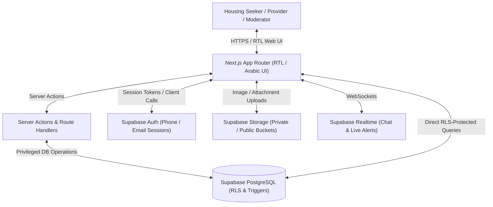

# SAKAN (سَكَن) Architecture & Engineering Specification

## 1. Executive Summary & Product Vision
**SAKAN (سَكَن)** is a modern, Arabic-first housing marketplace engineered specifically for Egyptian students and workers.
- **Tagline**: "سكنك أقرب. وحقك محفوظ."
- **Core Value Proposition**: Direct seeker-to-provider connections with **zero brokerage commissions**, transparent pricing in EGP, privacy protection, and fair complaint moderation.
- **Platform Scope**: Not an escrow or payment gateway in v1; focuses on verified listing discovery, secure in-app communication, and algorithmic request matching ("دوّرلي على سكن").

---

## 2. System Architecture



### 2.1 Technology Stack
- **Frontend Framework**: Next.js 16 (App Router) with React 19 and TypeScript in Strict Mode.
- **Styling**: Tailwind CSS v4, Arabic typography system, responsive RTL layouts.
- **Database**: PostgreSQL 15+ hosted on Supabase, version-controlled SQL migrations.
- **Access Control**: PostgreSQL Row-Level Security (RLS) on every application table.
- **Authentication**: Supabase Auth with Egyptian phone normalization (+20 / 01x) and password security.
- **Realtime**: WebSockets via Supabase Realtime for instant messaging and notifications.
- **Storage**: Supabase Storage with bucket-level policies and mime-type/size validations.

---

## 3. Directory Layout
```
sakan/
├── docs/                      # Architectural & security specifications
│   ├── architecture.md
│   ├── database-schema.md
│   ├── security.md
│   ├── deployment.md
│   └── testing.md
├── supabase/
│   ├── migrations/            # Versioned SQL migrations (001, 002, 003)
│   └── seeds/                 # Test fixtures for local development
├── src/
│   ├── app/                   # Next.js App Router pages and APIs
│   │   ├── (auth)/            # Auth routes (login, signup, recovery)
│   │   ├── (marketplace)/     # Listings, details, create, edit
│   │   ├── admin/             # Role-protected administrative dashboard
│   │   ├── messages/          # Private real-time chat
│   │   ├── wanted-requests/   # "دوّرلي على سكن" matching engine
│   │   ├── profile/           # User profile and account preferences
│   │   ├── complaints/        # Anti-commission and safety reporting
│   │   └── api/               # Server-side API endpoints & webhooks
│   ├── components/            # Reusable accessible Arabic RTL components
│   ├── lib/                   # Supabase clients, validators, utilities
│   └── types/                 # Shared TypeScript models and schemas
├── tests/                     # Unit, integration, and security tests
└── README.md                  # Project overview and run instructions
```
