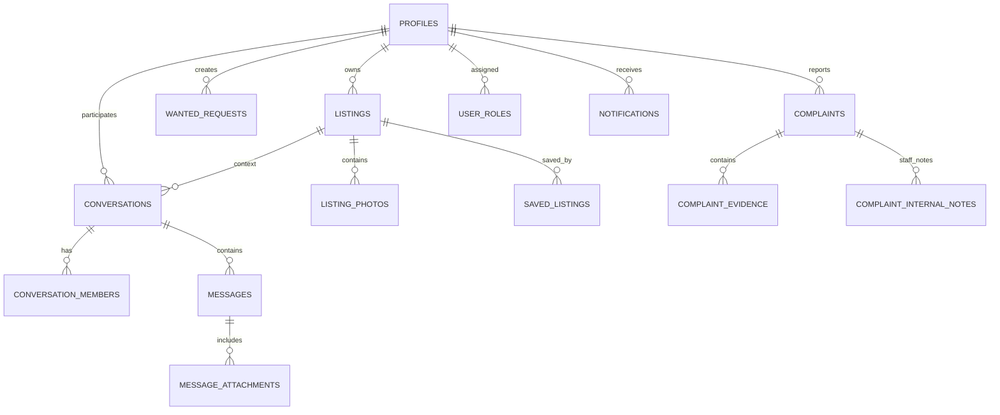

# SAKAN Database Schema Specification

## 1. Overview
The database uses PostgreSQL managed through Supabase migrations.
All primary keys use UUIDs (`gen_random_uuid()` or `uuid-ossp`).
All timestamps are stored in UTC (`timestamptz`) and localized to Egypt Standard Time (`UTC+02:00` or `UTC+03:00` daylight) in the presentation layer.

---

## 2. Entity-Relationship Diagram

---

## 3. Core Tables Reference

### 3.1 `profiles`
Extends `auth.users` with Egyptian public and private profile details.
- `id` (UUID PK): References `auth.users(id)` ON DELETE CASCADE.
- `full_name` (Text NOT NULL): User display name in Arabic/English.
- `phone` (Text): Normalized Egyptian phone number (`+201xxxxxxxxx`).
- `phone_verified` (Boolean): Phone SMS verification flag.
- `avatar_url` (Text): Public URL from `avatars` storage bucket.
- `role_preference` (Text): `'seeker' | 'provider' | 'both'`.
- `bio` (Text): User description.
- `is_suspended` (Boolean NOT NULL DEFAULT false): Account moderation suspension flag.
- `suspension_reason` (Text): Internal reason recorded by staff.
- `created_at`, `updated_at` (Timestamptz).

### 3.2 `user_roles`
Staff permissions model separating normal users from platform operators.
- `user_id` (UUID) references `auth.users(id)`.
- `role` (Text): `'super_admin' | 'admin' | 'listing_moderator' | 'complaint_reviewer' | 'analyst'`.
- `assigned_by` (UUID) references `auth.users(id)`.
- Primary Key: `(user_id, role)`.

### 3.3 `listings`
Egyptian housing units (room, shared apartment, full apartment, studio).
- `id` (UUID PK).
- `owner_id` (UUID references `auth.users(id)`).
- `title` (Text NOT NULL).
- `description` (Text NOT NULL).
- `governorate` (Text NOT NULL): One of the 27 Egyptian Governorates.
- `area` (Text NOT NULL): Neighborhood (e.g. مدينة نصر, الدقي, سموحة, حي الجامعة).
- `address_private` (Text): Exact street/building address, private until explicitly shared.
- `housing_type` (`'room' | 'shared_apartment' | 'full_apartment' | 'studio'`).
- `eligible_occupants` (`'students' | 'workers' | 'both'`).
- `gender_preference` (`'any' | 'male' | 'female'`).
- `monthly_rent` (Numeric CHECK > 0).
- `deposit` (Numeric CHECK >= 0).
- `utilities_cost` (Numeric CHECK >= 0).
- `furnished` (Boolean).
- `available_from` (Date).
- `amenities` (Text[]).
- `status` (`'draft' | 'pending' | 'published' | 'paused' | 'rejected' | 'removed' | 'rented'`).
- `rejection_reason` (Text).
- `room_occupancy_type` (`'shared' | 'private'`).
- `beds_count`, `rooms_count`, `bathrooms_count`, `max_occupancy` (Integer).
- `show_phone_publicly` (Boolean DEFAULT false).
- `views_count` (Integer DEFAULT 0).

### 3.4 `wanted_requests` ("دوّرلي على سكن")
Saved housing searches for proactive matching.
- Triggers notification when a matching listing transitions to `published`.
- Avoids duplicate notifications via compound existence check.
